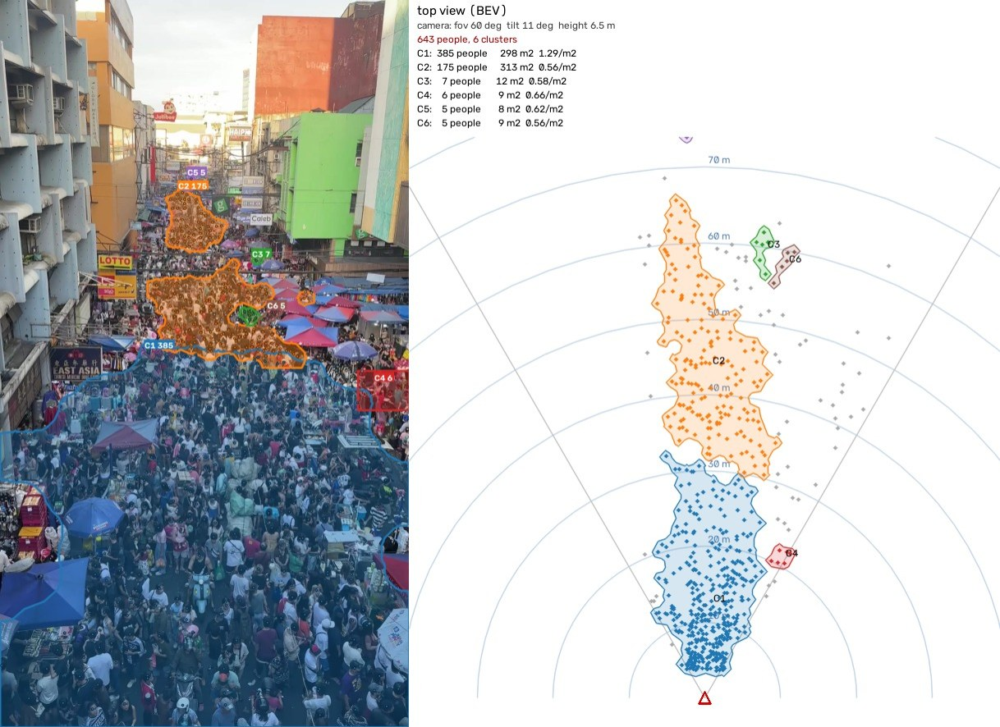

# CodeNet

**CoDE-Net (Crowd of Depth Estimation Net)**: monocular crowd analysis in metric space. From a single RGB frame
of an uncalibrated camera, one network finds every head, estimates the camera (field of view, tilt, roll,
height) and places each person on the ground in metres. People are then grouped into crowd clusters with
area and density, drawn both on the top view (BEV) and back on the image.

- 4.74M parameters, one forward pass, no calibration or homography
- 189 FPS network-only (TensorRT FP16, 1280x704, RTX 3090); 28-50 FPS end-to-end in PyTorch incl. clustering
- Median distance error 14-41 % on held-out drone video from 4 m to 100 m camera height

## Architecture

<div align="center">
  
</div>

- **Backbone / neck**: own CSP-ELAN stages of re-parameterisable RepConv blocks (BN + ReLU only, folded to
  plain 3x3 convs for deployment), space-to-depth stem for tiny heads, one linear-attention block at stride 32,
  top-down P5 -> P2 neck with per-pixel scale selection.
- **Point heads**: stride 8 (4 reference points per cell) and stride 4, a density gate picks one per region;
  local-max suppression and top-K run inside the graph.
- **Camera head**: FoV, pitch, roll and camera height from global context.
- **Per-person geometry**: log metric distance with a Laplace scale.
- **Metric lift**: each head pixel becomes a gravity-aligned ray. Its distance fuses the head-plane
  intersection (precise for steep rays) with the learned distance (the only cue near the horizon) by
  inverse variance, so far people keep a position and an uncertainty.
- **Post-processing**: DBSCAN on the ground plane with an uncertainty-aware metric (the radial separation is
  divided by the person's distance uncertainty, capped), then large crowds are split at density valleys of a
  smoothed BEV density map (two groups joined by a thin band become separate clusters; a uniformly dense crowd
  stays one). Metric polygons, area and density; image outlines drawn around the detected heads. GPU pair test;
  ~10-25 ms for 1,000-2,300 people.

## Structure

```
.
├── model/model.py             CoDE-Net (shared verbatim with the training code)
├── infer/
│   ├── infer.py               CodeNetPredictor class / CLI (image, folder, video)
│   ├── postprocess.py         camera smoothing, BEV clustering, polygons, area / density
│   ├── visualize.py           image overlay and top-view rendering (OpenCV)
│   └── ckpt_crypto.py         encrypted checkpoint loader
├── checkpoints/codenet_m.pth.enc
├── results/
│   ├── images/                overlay + BEV examples
│   └── videos/                5 s input clips and their CoDE-Net renders
├── img/architecture.png
├── Dockerfile
└── requirements.txt
```

## Setup

```bash
pip install -r requirements.txt
```

or `docker build -t codenet .` (see `Dockerfile`).

## Checkpoints

The checkpoint is encrypted. Set the key (available from the author) before running:

```bash
export CKPT_KEY=<key>
```

## Inference

```bash
cd infer
python infer.py image.jpg --out out/                 # out/image_codenet.jpg (overlay | BEV) + .json
python infer.py frames/   --out out/                 # every image in a folder
python infer.py video.mp4 --out out/ --fixed-camera  # static camera: camera = running median over frames
python infer.py video.mp4 --out out/ --start 10 --seconds 5
python infer.py image.jpg --camera 60 25 0 8.5       # known camera: FoV, pitch, roll (deg), height (m)
```

```python
from infer import CodeNetPredictor

pred = CodeNetPredictor('../checkpoints/codenet_m.pth.enc')   # fixed_camera=True for a static camera stream
res = pred(bgr)
res['uv']          # (N, 2) head pixels
res['bev']         # (N, 2) ground position X (right), Z (forward) in metres, camera at the origin
res['sigma']       # (N,)   distance uncertainty (log units)
res['camera']      # fov, pitch, roll [rad], height [m]
res['labels']      # (N,)   cluster index, -1 = not in a cluster
res['clusters']    # count, area (m2), density (people / m2), BEV polygons (m), image polygons (px)
```

The JSON written by the CLI has the same content (`camera`, `people`, `clusters`).

Clustering parameters (`ClusterCfg` in `postprocess.py`): neighbour distance `eps` 1.5 m, `min_nb` 3
neighbours for a core person, `min_people` 5; clusters wider than `split_extent` 10 m are split where the
density drops below `split_valley` 0.7 x the lower peak (density map smoothed by `split_sigma` 1.5 m);
polygon margin 0.8 m. Lower `split_valley` / larger `split_sigma` give fewer, larger clusters.

## Results

Frames from public crowd footage (not used in training). Left: detected heads and crowd clusters projected
on the image; right: the same people on the ground plane (10 m rings, camera at the red triangle).

<div align="center">
  
  
  
</div>

### Videos (5 s)

| Scene | Input | CoDE-Net |
|---|---|---|
| Parade, aerial (50 fps) | [parade_aerial_input.mp4](results/videos/parade_aerial_input.mp4) | [parade_aerial_codenet.mp4](results/videos/parade_aerial_codenet.mp4) |
| Market street, elevated camera (60 fps) | [market_street_input.mp4](results/videos/market_street_input.mp4) | [market_street_codenet.mp4](results/videos/market_street_codenet.mp4) |

Rendered with `--fixed-camera --camera-window 15`.

### Accuracy

Head localisation on human-labelled sets (F1 at the released score threshold 0.3):

| Set | F1 |
|---|---|
| Unseen subway CCTV camera | 0.827 |
| FDST | 0.893 |
| ShanghaiTech B | 0.811 |
| ShanghaiTech A | 0.726 |
| JHU-Crowd++ | 0.681 |

Metric distance on held-out drone video (MovingDroneCrowd++ test clips, DroneCrowd hold-out sequences),
binned by camera height; median per-person distance error against the geometry teacher:

| Camera height | 0-10 m | 10-20 m | 20-40 m | 40-70 m | 70-200 m |
|---|---|---|---|---|---|
| Distance error | 25.5 % | 30.3 % | 34.9 % | 13.8 % | 40.9 % |
| Camera height error | 58 % | 21 % | 31 % | 21 % | 44 % |

### Speed (RTX 3090, batch 1)

| | 1280x704 | 960x544 |
|---|---|---|
| Network, TensorRT FP16 | 5.3 ms (189 FPS) | 3.3 ms (302 FPS) |
| Network, PyTorch | 6.0 ms | 6.3 ms |
| Pre-processing + network, PyTorch (4K / 2.5K video frame) | 11.5-13.8 ms | |
| + clustering and polygons (1,000-2,300 people) | +9-23 ms | |

The network time includes decoding and the metric lift. TensorRT 8.5 limits in-graph top-K to 3840 people;
export with `cfg.topk = 3840` or decode outside the engine for larger crowds.

## Limitations

- The ground is assumed flat and every head 1.65 m above it. People on rooftops, balconies, tiered seating or
  stairs get a wrong top-view position (usually left out of clusters or placed too far).
- False detections on strongly textured roofs (e.g. clay roof tiles seen from a drone) can form small clusters.
- The camera tilt of portrait (vertical) drone frames tends to be under-estimated; far people then lie above
  the estimated horizon and keep only the learned distance.
- Very oblique long-range aerial shots (horizon in view, crowd > 100 m away) are under-estimated in
  distance; the training drones look down steeply.
- Pinhole camera model; strong fisheye distortion shifts positions near the image border.
- The camera is estimated per frame; use `--fixed-camera` for static cameras, or `--camera` when the
  camera is known (fixes the two points above for that camera).

## License

All rights reserved.

## Data

Training data (training code in a separate repository): NWPU-Crowd, ShanghaiTech A/B, JHU-Crowd++
(CC BY-NC-SA 4.0), FDST, MovingDroneCrowd++ (CC BY-NC 4.0), DroneCrowd (academic, non-commercial), and
private CCTV recordings with pseudo-labels. Several of these datasets are licensed for non-commercial use
only; check their terms before any commercial use of the weights.

Demo footage in `results/`: free stock crowd videos (IDs 15544657, 17178494, 14931663), not used in training.
