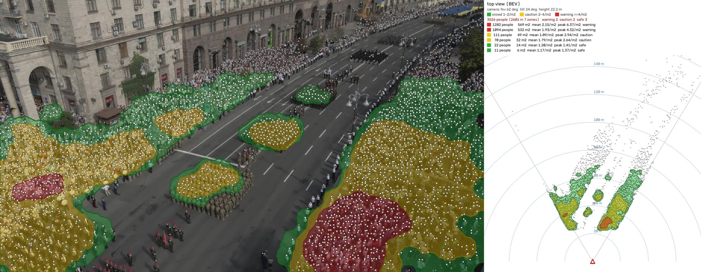

# CodeNet

**CoDE-Net (Crowd of Depth Estimation Net)**: every person's metric position on the ground from a single
uncalibrated RGB frame. Heads, camera (FoV, tilt, height) and per-person distance come out of one forward pass;
a ground-plane density map then gives crowd zones with area, density and a risk level (safe / caution / warning).

- 4.78M parameters
- 181 FPS (TensorRT FP16, 1280x704, 24 GB GPU); 16-45 FPS end-to-end in PyTorch incl. zones
- No calibration, homography or per-site setup
- Dense crowds: 4 points per 4x4 px cell and a per-block head count instead of non-maximum suppression

## Architecture

<div align="center">
  
</div>

## Structure

```
.
├── model/model.py             CoDE-Net
├── infer/
│   ├── infer.py               inference class / CLI (image, folder, video)
│   ├── postprocess.py         BEV density field, crowd zones, polygons
│   ├── visualize.py           overlay and top-view rendering
│   └── ckpt_crypto.py         encrypted checkpoint loader
├── checkpoints/codenet_m.pth.enc
├── results/                   example images and videos
├── Dockerfile
└── requirements.txt
```

## Setup

```bash
pip install -r requirements.txt
```

## Checkpoints

The checkpoint is encrypted. Set the key (available from the author) before running:

```bash
export CKPT_KEY=<key>
```

## Inference

```bash
cd infer
python infer.py image.jpg --out out/                  # overlay | top view (.jpg) + people / zones (.json)
python infer.py video.mp4 --out out/ --fixed-camera   # static camera: median camera + time-smoothed zones
python infer.py video.mp4 --out out/ --risk 2 4       # local density (people/m2) for caution / warning
```

Zones are regions where the local density (people within ~1 m, on the ground plane) is at least 1 person/m2 (green);
areas inside them at 2-4 people/m2 are yellow and at >= 4 red, and a zone's level is its highest colour. A continuous
crowd stays one zone. For a static camera (`--fixed-camera` or `--camera`) the density map is averaged over time and
levels change with hysteresis (`--no-smooth` to disable; not for moving cameras).

```python
from infer import CodeNetPredictor

pred = CodeNetPredictor('../checkpoints/codenet_m.pth.enc')
res = pred(bgr)     # uv (px), bev (m), camera, labels, zones (count, area m2, mean / peak density, level, polygons)
```

## Results

<div align="center">
  
  
</div>

Videos (5 s): [parade input](results/videos/parade_aerial_input.mp4) /
[parade CoDE-Net](results/videos/parade_aerial_codenet.mp4),
[street festival input](results/videos/street_festival_input.mp4) /
[street festival CoDE-Net](results/videos/street_festival_codenet.mp4)

| | Value |
|---|---|
| Params | 4.78M |
| Speed (TensorRT FP16, 1280x704) | 181 FPS |
| Head F1 (unseen CCTV / FDST / SHB / SHA / JHU) | 0.825 / 0.887 / 0.813 / 0.725 / 0.712 |

## Distance vs camera height

Median per-person distance error on held-out drone video (MovingDroneCrowd++ test, DroneCrowd hold-out),
binned by camera height:

| Camera height | 0-10 m | 10-20 m | 20-40 m | 40-70 m | 70-200 m |
|---|---|---|---|---|---|
| Distance error | 27.9 % | 31.8 % | 31.7 % | 12.7 % | 12.5 % |

Flat ground is assumed: people on rooftops, balconies or tiered seating get a wrong top-view position.

## License

All rights reserved.

## Data

NWPU-Crowd, ShanghaiTech A/B, JHU-Crowd++ (CC BY-NC-SA 4.0), FDST, MovingDroneCrowd++ (CC BY-NC 4.0),
DroneCrowd (non-commercial), private CCTV (pseudo-labelled). Demo footage: stock videos 17178494, 15544657,
14931663 (not used in training).
