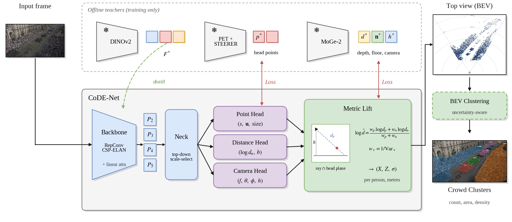
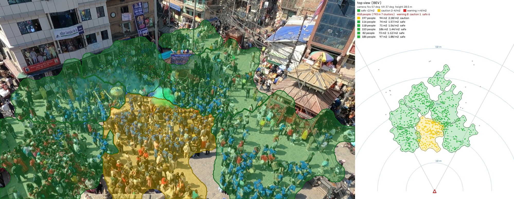

# CodeNet

**CoDE-Net (Crowd of Depth Estimation Net)**: every person's metric position on the ground from a single
uncalibrated RGB frame. Heads, camera (FoV, tilt, height) and per-person distance come out of one forward pass;
people are then grouped into crowd clusters with area, density and a risk level (safe / caution / warning).

- 4.74M parameters
- 189 FPS (TensorRT FP16, 1280x704, 24 GB GPU); 18-50 FPS end-to-end in PyTorch incl. clustering
- No calibration, homography or per-site setup

## Architecture

<div align="center">
  
</div>

## Structure

```
.
├── model/model.py             CoDE-Net
├── infer/
│   ├── infer.py               inference class / CLI (image, folder, video)
│   ├── postprocess.py         BEV clustering, polygons, area / density
│   ├── visualize.py           overlay and top-view rendering
│   └── ckpt_crypto.py         encrypted checkpoint loader
├── checkpoints/codenet_m.pth.enc
├── results/                   example images and videos
├── Dockerfile
└── requirements.txt
```

## Setup

```bash
pip install -r requirements.txt
```

## Checkpoints

The checkpoint is encrypted. Set the key (available from the author) before running:

```bash
export CKPT_KEY=<key>
```

## Inference

```bash
cd infer
python infer.py image.jpg --out out/                  # overlay | top view (.jpg) + people / clusters (.json)
python infer.py video.mp4 --out out/ --fixed-camera   # static camera: median camera + temporally stable clusters
python infer.py video.mp4 --out out/ --risk 2 4       # density thresholds (people/m2) for caution / warning
```

Cluster colours: green < 2, yellow 2-4, red >= 4 people/m2. For a static camera (`--fixed-camera` or `--camera`) the
clusters are tracked: the last 8 frames are clustered together, group centres persist with a track id, and density
and risk level are smoothed with hysteresis (`--no-track` to disable; not for moving cameras).

```python
from infer import CodeNetPredictor

pred = CodeNetPredictor('../checkpoints/codenet_m.pth.enc')
res = pred(bgr)     # uv (px), bev (m), camera, labels, clusters (count, area m2, density, level, polygons)
```

## Results

<div align="center">
  
  
</div>

Videos (5 s): [parade input](results/videos/parade_aerial_input.mp4) /
[parade CoDE-Net](results/videos/parade_aerial_codenet.mp4),
[street festival input](results/videos/street_festival_input.mp4) /
[street festival CoDE-Net](results/videos/street_festival_codenet.mp4)

| | Value |
|---|---|
| Params | 4.74M |
| Speed (TensorRT FP16, 1280x704) | 189 FPS |
| Head F1 (unseen CCTV / FDST / SHB / SHA / JHU) | 0.83 / 0.89 / 0.81 / 0.73 / 0.68 |

## Distance vs camera height

Median per-person distance error on held-out drone video (MovingDroneCrowd++ test, DroneCrowd hold-out),
binned by camera height:

| Camera height | 0-10 m | 10-20 m | 20-40 m | 40-70 m | 70-200 m |
|---|---|---|---|---|---|
| Distance error | 25.5 % | 30.3 % | 34.9 % | 13.8 % | 40.9 % |

Flat ground is assumed: people on rooftops, balconies or tiered seating get a wrong top-view position.

## License

All rights reserved.

## Data

NWPU-Crowd, ShanghaiTech A/B, JHU-Crowd++ (CC BY-NC-SA 4.0), FDST, MovingDroneCrowd++ (CC BY-NC 4.0),
DroneCrowd (non-commercial), private CCTV (pseudo-labelled). Demo footage: stock videos 17178494, 15544657,
14931663 (not used in training).
